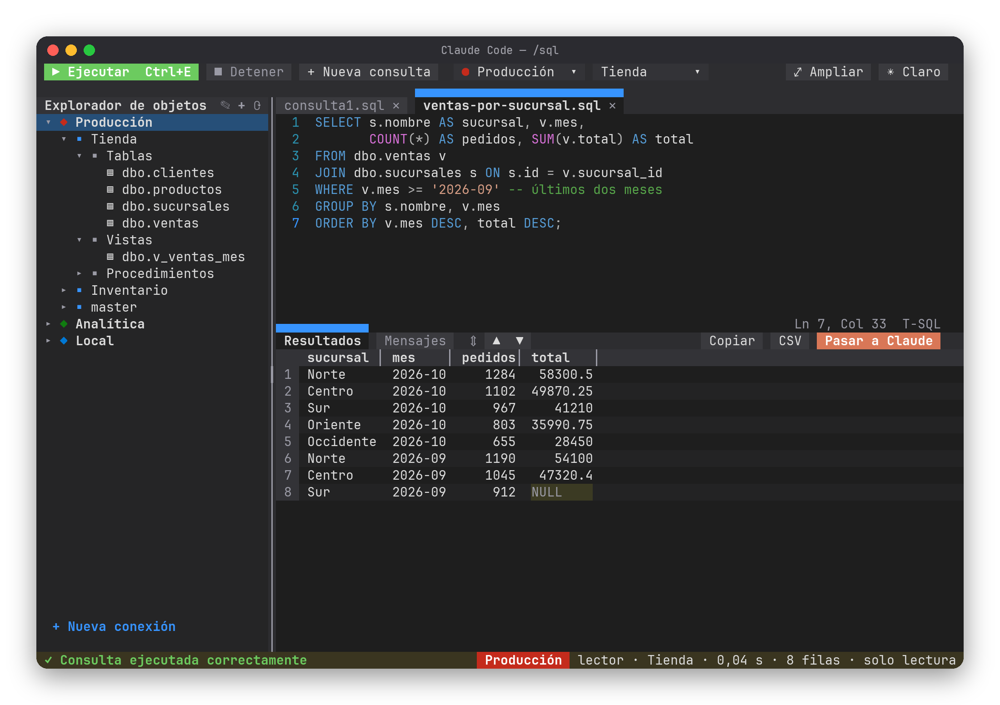
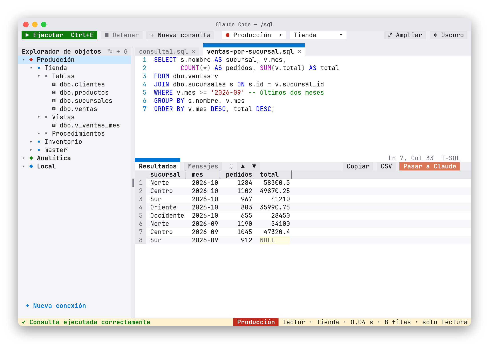

# 🗄️ Estudio SQL — un cliente SQL dentro de Claude Code

Un mod para [Claude Code](https://claude.com/claude-code) que abre un cliente SQL con aspecto de **SQL Server Management Studio** en la misma terminal: tus conexiones, un explorador de objetos, un editor con colores y los resultados en cuadrícula. Y Claude puede consultar tus bases **a la vista**, en una pestaña que tú ves.

**SQL Server · PostgreSQL · MySQL / MariaDB · SQLite**

**Requisitos:** Claude Code **2.1.303 o más reciente**, en la terminal, con unas **110 columnas** de ancho (o pantalla completa). Probado en **Linux** (x64); hecho para **Windows 10/11** con Windows Terminal (x64, y ARM con emulación). Los binarios de macOS están incluidos, pero sin probar. No hay que instalar drivers, ODBC, Go ni Node: el mod trae su propio programa para cada sistema. Opcional en Linux: `wl-clipboard` o `xclip` para copiar, y un llavero (GNOME Keyring o KWallet) para guardar contraseñas.

> **🤖 Si eres Claude y te pasaron este enlace para instalar el mod:** no lo instales con `/plugin install`. Sigue paso a paso [INSTALAR.md](https://raw.githubusercontent.com/waldooCreator/claude-code-estudio-sql/main/INSTALAR.md) (léelo completo antes de empezar). Ahí se clona en una carpeta, se comprueba en este equipo, se instala para todas las sesiones y se crea la primera conexión.



## Instalar: pídeselo a Claude (recomendado, sobre todo en Windows)

Abre Claude Code y pégale esto:

```
Instala el mod estudio-sql desde https://github.com/waldooCreator/claude-code-estudio-sql siguiendo su INSTALAR.md, para todas mis sesiones.
```

Claude lo descarga en una carpeta tuya, comprueba que su puente arranca en tu equipo, lo valida y lo instala para **todas tus sesiones y cualquier carpeta**. Al final te pedirá escribir `/reload-plugins` una vez y te ayudará a crear tu primera conexión. Luego abre el panel con:

```
/sql
```

Para comprobar en cualquier momento que todo está bien (puente, llavero, portapapeles):

```
/sql-diagnostico
```

<details>
<summary>Instalarlo a mano</summary>

Escribe esto en el prompt de Claude Code (queda activo, pero Claude no podrá adaptarlo después porque se instala una copia):

```
/plugin install estudio-sql --marketplace waldooCreator/claude-code-estudio-sql
```

Responde `y` y elige el alcance **user** para que quede en todas tus sesiones.

Desde una carpeta clonada (lo que hace Claude con `INSTALAR.md`; así los cambios en la carpeta llegan con `/reload-plugins`):

```bash
git clone https://github.com/waldooCreator/claude-code-estudio-sql
claude plugin marketplace add ./claude-code-estudio-sql
claude plugin install estudio-sql@estudio-sql --scope user
```

Para probarlo una sola vez sin instalarlo, en una terminal aparte:

```bash
claude --plugin-dir ./claude-code-estudio-sql
```

</details>

## En 30 segundos

1. `/sql` abre el panel.
2. **+ Nueva conexión**: elige el motor, escribe servidor, usuario y contraseña, y pulsa **Probar conexión**. En SQL Server, una instancia con nombre se escribe en el servidor (`EQUIPO\SQLEXPRESS`) y, en Windows, **Usuario vacío entra con tu sesión de Windows**.
3. Despliega la conexión en el explorador para ver bases, tablas, vistas y procedimientos.
4. Escribe tu consulta y ejecútala con **Ctrl+E**.

## Qué trae

| | |
| --- | --- |
| 🧭 **Explorador de objetos** | Conexiones → bases → tablas, vistas y procedimientos. Su borde se arrastra para darle más ancho. |
| ✍️ **Editor con pestañas** | Colores de SQL, números de línea, varias consultas abiertas a la vez. |
| 📋 **Resultados en cuadrícula** | Varios conjuntos, `NULL` resaltado, clic derecho → **Copiar celda**, botones **Copiar** (TSV) y **CSV**. |
| ✏️ **Editar celdas** | Doble clic en una celda, escribe y `Enter`: ves el `UPDATE` exacto y otro `Enter` lo guarda. Detalles abajo. |
| ↕️ **Barras de desplazamiento** | En la consulta y en los resultados, vertical y horizontal: flechas, clic en la pista y pulgar arrastrable. |
| 🤖 **Pasar a Claude** | Manda la consulta y una muestra del resultado a la conversación para que Claude lo analice. |
| 🔒 **Solo lectura por conexión** | Ideal para producción: rechaza `INSERT`, `UPDATE`, `DELETE`, `DROP`, `EXEC`… |
| 🔑 **Contraseñas en el llavero** | Se guardan en el llavero del sistema (Administrador de credenciales de Windows, Secret Service en Linux, Llavero en macOS), nunca en texto plano. |
| 🪟 **SQL Server en Windows** | Instancias con nombre (`EQUIPO\SQLEXPRESS`, vía SQL Server Browser) y autenticación de Windows: deja Usuario vacío. |
| 🛡️ **Túnel SSH** | Para bases que solo se alcanzan a través de otro equipo. Usa tu agente SSH o una llave, y verifica `known_hosts`. |
| 🎨 **Color por conexión** | La barra de estado toma el color de la conexión: el rojo de producción no se confunde. |
| 🌗 **Tema claro y oscuro** | Botón **◐** arriba a la derecha. |



## Claude consulta a la vista

El mod le da a Claude la herramienta `consultar`. Cuando le pides algo como *«¿cuánto vendió cada sucursal en octubre?»*, Claude:

1. abre una pestaña nueva en el panel con su consulta,
2. la ejecuta **siempre en solo lectura**,
3. y recibe la tabla para responderte.

Tú ves exactamente qué corrió y qué devolvió. Si Claude no sabe el nombre de la conexión, la herramienta le responde con la lista de las que tienes.

## Editar una celda

Doble clic en una celda de los resultados abre un recuadro con su valor:

1. escribe el valor nuevo (`NULL` deja la celda vacía) y pulsa `Enter`;
2. el recuadro muestra el `UPDATE` exacto que se va a ejecutar;
3. `Enter` otra vez (o **Confirmar**) lo ejecuta. **Cancelar** o un clic fuera lo descarta.

Se puede editar cuando la conexión **no** es de solo lectura y la consulta lee de **una sola tabla con clave primaria**, y esa clave está entre las columnas (un `SELECT *` sirve). Si no, el recuadro dice por qué. Las columnas calculadas o de identidad no se editan. En SQL Server y PostgreSQL el servidor dice de qué tabla sale cada columna; en MySQL y SQLite se reconoce la forma `SELECT … FROM tabla`.

El `UPDATE` corre en una transacción que solo se confirma si cambia exactamente una fila, y antes revisa que nadie haya cambiado ese valor mientras lo editabas. Si el motor lo rechaza, su error se ve entero en el recuadro y lo escrito se conserva para corregirlo.

## Atajos

| Tecla | Qué hace |
| --- | --- |
| `Ctrl+E` · `F5` · `Ctrl+Enter` | Ejecutar la consulta de la pestaña |
| `Ctrl+A` | Seleccionar todo el editor |
| `Ctrl+K` | Copiar la selección (o toda la consulta) |
| `Ctrl+X` · `Ctrl+V` | Cortar · pegar |
| `↑ ↓ ← →` · `RePág` · `AvPág` | Moverse por los resultados |
| Arrastrar `┃` y `⇕` | Cambiar el ancho del explorador y el alto del editor |

> `Ctrl+C` no llega al panel: la terminal lo usa para soltarlo. Por eso copiar es `Ctrl+K`.

## Dónde quedan tus datos

- **Conexiones** (sin contraseñas): en el almacén de mods de Claude Code, `~/.claude/plugins/store/estudio-sql_…json` (en Windows, `%USERPROFILE%\.claude\plugins\store\estudio-sql_…json`).
- **Contraseñas**: en el llavero del sistema, con el servicio `estudio-sql` y el id de la conexión: el **Administrador de credenciales de Windows**, el **Secret Service** de Linux (GNOME Keyring o KWallet) o el **Llavero** de macOS. Borrar la conexión en el panel borra también su contraseña.
- **Linux sin llavero** (WSL, servidores sin escritorio, sesiones por SSH): no hay dónde guardar contraseñas. Al guardar, el panel avisa «La conexión se guardó, pero la contraseña no» y explica qué instalar (`gnome-keyring`). Las conexiones sin contraseña (SQLite) funcionan igual. `/sql-diagnostico` dice si el llavero responde.

## Cómo funciona

Un mod de Claude Code no puede abrir conexiones de red por sí mismo. Por eso viene con un **puente**: un pequeño programa en Go (uno por sistema, en `bin/`) que habla con las bases de datos y responde al mod por HTTP. En Linux y macOS lo hace por un socket Unix privado; en Windows, por `127.0.0.1` en un puerto libre, con un token aleatorio que solo conoce el mod (si el socket no funciona en algún equipo, el mod pasa solo a ese modo). El puente se cierra solo cuando se cierra Claude Code.

Copiar usa `wl-copy`, `xclip` o `xsel` en Linux (si no hay, la terminal por OSC 52), `pbcopy` en macOS y PowerShell en Windows (en UTF-8, para que las tildes y la ñ lleguen bien).

```
hooks/register.tsx   arranca el puente, guarda las conexiones y registra /sql y la herramienta consultar
hooks/estudio.tsx    el panel: explorador, editor, resultados y diálogos
hooks/dibujo.ts      utilidades para dibujar en celdas
puente/              el puente en Go (drivers, llavero, túnel SSH)
bin/                 el puente compilado: Linux y macOS (amd64 y arm64) y Windows (amd64; en ARM corre emulado)
tests/               pruebas (claude plugin test)
```

## Desarrollo

```bash
cd puente && go test ./... && cd ..   # pruebas del puente (DSN, instancias, token TCP)
claude plugin test .      # corre las pruebas
claude --plugin-dir .     # abre una sesión con el mod cargado desde esta carpeta
```

Las pruebas del puente corren siempre contra SQLite; contra los demás motores, si les das un servidor de prueba (por ejemplo en contenedores):

```bash
cd puente
ESQL_MSSQL=127.0.0.1:51433 ESQL_CLAVE_MSSQL=… \
ESQL_PG=127.0.0.1:55432 ESQL_CLAVE_PG=… \
ESQL_MY=127.0.0.1:53306 ESQL_CLAVE_MY=… go test ./...
```

Para probar el puente por TCP en Linux, como en Windows: `ESTUDIO_SQL_TCP=1` (o la bandera `-tcp`).

Para recompilar el puente (Go 1.26):

```bash
cd puente
for t in linux/amd64 linux/arm64 darwin/amd64 darwin/arm64 windows/amd64; do
  os=${t%/*}; arch=${t#*/}; ext=$([ "$os" = windows ] && echo .exe)
  # a un temporal y luego encima: el binario puede estar en uso por una sesión abierta
  CGO_ENABLED=0 GOOS=$os GOARCH=$arch go build -trimpath -ldflags="-s -w" -o ../bin/.nuevo .
  mv -f ../bin/.nuevo ../bin/puente-$os-$arch$ext
done
```

<details>
<summary>🇬🇧 In English</summary>

**Estudio SQL** is a Claude Code mod that opens an SSMS-style SQL client inside your terminal: saved connections, an object explorer, a syntax-highlighted editor with tabs and a results grid. It supports SQL Server, PostgreSQL, MySQL/MariaDB and SQLite, read-only connections, SSH tunnels and passwords stored in the OS keychain. It also gives Claude a `consultar` tool so it can run **read-only** queries in a tab you can see.

Install: ask Claude Code to *install estudio-sql from https://github.com/waldooCreator/claude-code-estudio-sql following its INSTALAR.md*, or run `/plugin install estudio-sql --marketplace waldooCreator/claude-code-estudio-sql`, then type `/sql` (`/sql-diagnostico` checks the setup). Requires Claude Code 2.1.303+ and a terminal about 110 columns wide. Tested on Linux; built for Windows 10/11 (named SQL Server instances and Windows authentication with an empty user). The UI is in Spanish.

</details>

## Aviso

Proyecto personal, **no oficial**: no está afiliado a Anthropic ni a Microsoft. SQL Server Management Studio es de Microsoft; solo se toma como inspiración visual.

## Licencia

[MIT](LICENSE)
