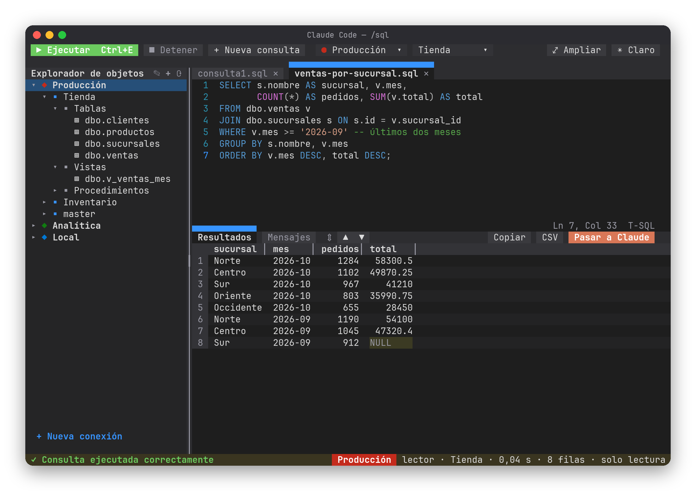
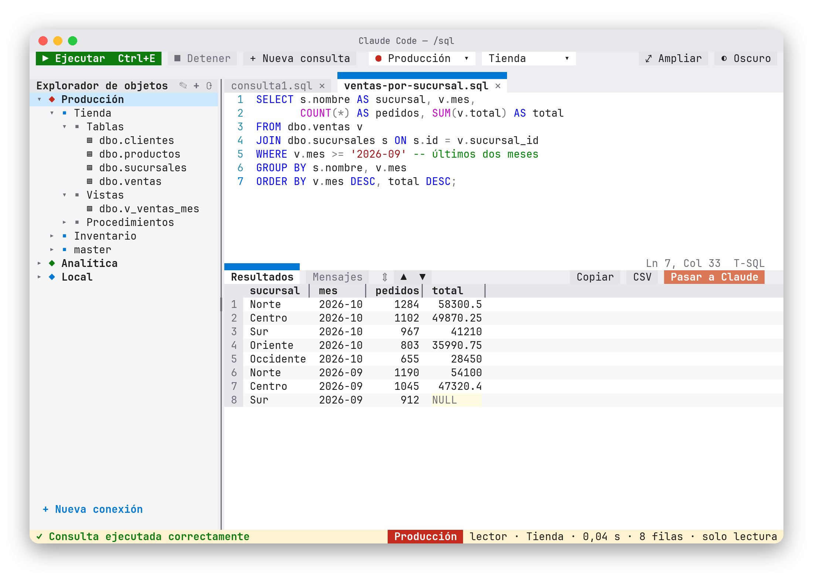

# 🗄️ Estudio SQL — un cliente SQL dentro de Claude Code

Un mod para [Claude Code](https://claude.com/claude-code) que abre un cliente SQL con aspecto de **SQL Server Management Studio** en la misma terminal: tus conexiones, un explorador de objetos, un editor con colores y los resultados en cuadrícula. Y Claude puede consultar tus bases **a la vista**, en una pestaña que tú ves.

**SQL Server · PostgreSQL · MySQL / MariaDB · SQLite** — Linux, macOS y Windows.



## Instalación

Escribe esto en el prompt de Claude Code:

```
/plugin install estudio-sql --marketplace waldooCreator/claude-code-estudio-sql
```

Responde `y` para agregar el marketplace y elige el alcance **user** (Enter). Queda activo en todas tus sesiones. Luego abre el panel con:

```
/sql
```

<details>
<summary>Otras formas de instalarlo</summary>

Desde una terminal normal:

```bash
claude plugin install estudio-sql --marketplace waldooCreator/claude-code-estudio-sql
```

Probarlo sin instalar:

```bash
git clone https://github.com/waldooCreator/claude-code-estudio-sql.git
claude --plugin-dir ./claude-code-estudio-sql
```

</details>

## En 30 segundos

1. `/sql` abre el panel.
2. **+ Nueva conexión**: elige el motor, escribe servidor, usuario y contraseña, y pulsa **Probar conexión**.
3. Despliega la conexión en el explorador para ver bases, tablas, vistas y procedimientos.
4. Escribe tu consulta y ejecútala con **Ctrl+E**.

## Qué trae

| | |
| --- | --- |
| 🧭 **Explorador de objetos** | Conexiones → bases → tablas, vistas y procedimientos. Su borde se arrastra para darle más ancho. |
| ✍️ **Editor con pestañas** | Colores de SQL, números de línea, varias consultas abiertas a la vez. |
| 📋 **Resultados en cuadrícula** | Varios conjuntos, `NULL` resaltado, clic derecho → **Copiar celda**, botones **Copiar** (TSV) y **CSV**. |
| 🤖 **Pasar a Claude** | Manda la consulta y una muestra del resultado a la conversación para que Claude lo analice. |
| 🔒 **Solo lectura por conexión** | Ideal para producción: rechaza `INSERT`, `UPDATE`, `DELETE`, `DROP`, `EXEC`… |
| 🔑 **Contraseñas en el llavero** | Se guardan en el llavero del sistema (Secret Service, Keychain o Credential Manager), nunca en texto plano. |
| 🛡️ **Túnel SSH** | Para bases que solo se alcanzan a través de otro equipo. Usa tu agente SSH o una llave, y verifica `known_hosts`. |
| 🎨 **Color por conexión** | La barra de estado toma el color de la conexión: el rojo de producción no se confunde. |
| 🌗 **Tema claro y oscuro** | Botón **◐** arriba a la derecha. |



## Claude consulta a la vista

El mod le da a Claude la herramienta `consultar`. Cuando le pides algo como *«¿cuánto vendió cada sucursal en octubre?»*, Claude:

1. abre una pestaña nueva en el panel con su consulta,
2. la ejecuta **siempre en solo lectura**,
3. y recibe la tabla para responderte.

Tú ves exactamente qué corrió y qué devolvió. Si Claude no sabe el nombre de la conexión, la herramienta le responde con la lista de las que tienes.

## Atajos

| Tecla | Qué hace |
| --- | --- |
| `Ctrl+E` · `F5` · `Ctrl+Enter` | Ejecutar la consulta de la pestaña |
| `Ctrl+A` | Seleccionar todo el editor |
| `Ctrl+K` | Copiar la selección (o toda la consulta) |
| `Ctrl+X` · `Ctrl+V` | Cortar · pegar |
| `↑ ↓ ← →` · `RePág` · `AvPág` | Moverse por los resultados |
| Arrastrar `┃` y `⇕` | Cambiar el ancho del explorador y el alto del editor |

> `Ctrl+C` no llega al panel: la terminal lo usa para soltarlo. Por eso copiar es `Ctrl+K`.

## Cómo funciona

Un mod de Claude Code no puede abrir conexiones de red por sí mismo. Por eso viene con un **puente**: un pequeño programa en Go (uno por sistema, en `bin/`) que habla con las bases de datos y responde al mod por HTTP sobre un socket Unix privado. El puente se cierra solo cuando se cierra Claude Code.

```
hooks/register.tsx   arranca el puente, guarda las conexiones y registra /sql y la herramienta consultar
hooks/estudio.tsx    el panel: explorador, editor, resultados y diálogos
hooks/dibujo.ts      utilidades para dibujar en celdas
puente/              el puente en Go (drivers, llavero, túnel SSH)
bin/                 el puente compilado para Linux, macOS y Windows (amd64 y arm64)
tests/               pruebas (claude plugin test)
```

## Desarrollo

```bash
claude plugin test .      # corre las pruebas
claude --plugin-dir .     # abre una sesión con el mod cargado desde esta carpeta
```

Para recompilar el puente (Go 1.26):

```bash
cd puente
for t in linux/amd64 linux/arm64 darwin/amd64 darwin/arm64 windows/amd64; do
  os=${t%/*}; arch=${t#*/}; ext=$([ "$os" = windows ] && echo .exe)
  CGO_ENABLED=0 GOOS=$os GOARCH=$arch go build -trimpath -ldflags="-s -w" -o ../bin/puente-$os-$arch$ext .
done
```

<details>
<summary>🇬🇧 In English</summary>

**Estudio SQL** is a Claude Code mod that opens an SSMS-style SQL client inside your terminal: saved connections, an object explorer, a syntax-highlighted editor with tabs and a results grid. It supports SQL Server, PostgreSQL, MySQL/MariaDB and SQLite, read-only connections, SSH tunnels and passwords stored in the OS keychain. It also gives Claude a `consultar` tool so it can run **read-only** queries in a tab you can see.

Install: `/plugin install estudio-sql --marketplace waldooCreator/claude-code-estudio-sql`, then type `/sql`. The UI is in Spanish.

</details>

## Aviso

Proyecto personal, **no oficial**: no está afiliado a Anthropic ni a Microsoft. SQL Server Management Studio es de Microsoft; solo se toma como inspiración visual.

## Licencia

[MIT](LICENSE)
